# RKU UniFind ✦

**The campus lost & found app built for students of Ryutsu Keizai University.**

Lost your wallet in the cafeteria? Found a set of keys near the library? UniFind helps RKU students report, search and reconnect lost belongings in a few taps, right from the phone.

<p align="center">
  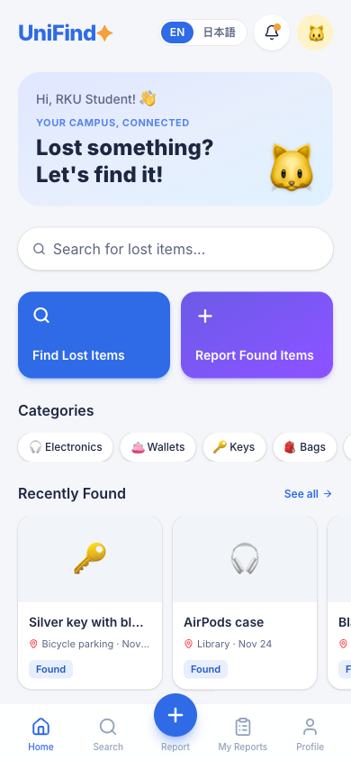
  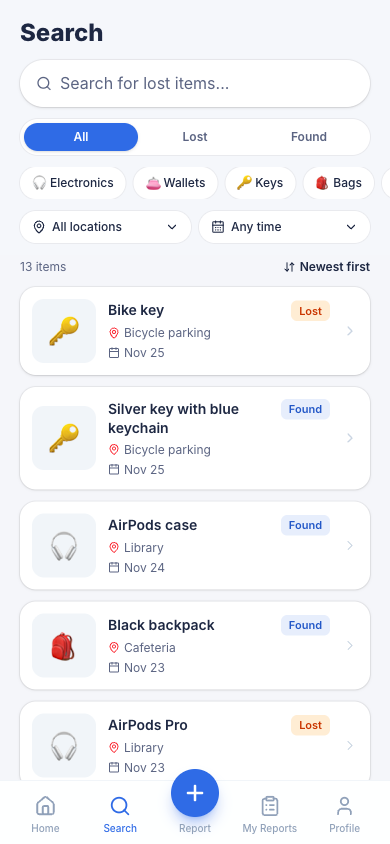
  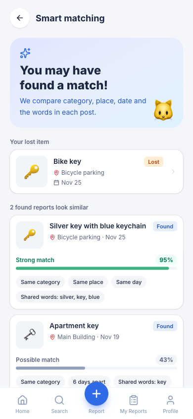
  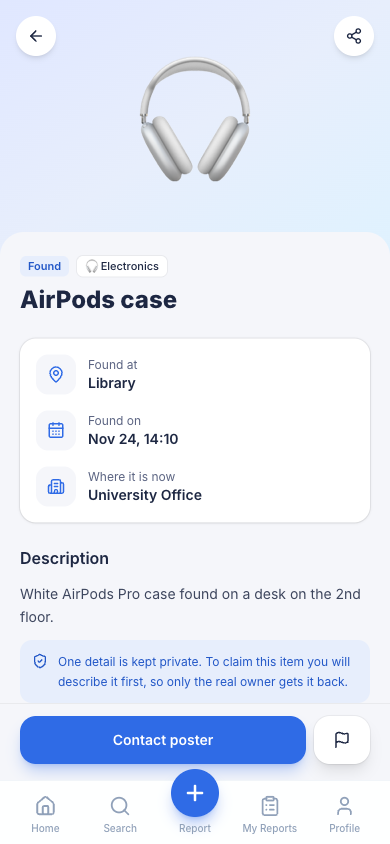
</p>

**[Live Demo → rku-unifind.vercel.app](https://rku-unifind.vercel.app/)**

> **Status:** interactive prototype (class project). It runs on realistic sample data with no backend, accounts or real messaging.

---

## Why UniFind?

Lost items on campus usually end up in a drawer at the office, a group chat nobody reads, or nowhere at all. Students who find something often don't know who to give it to, and students who lose something don't know where to look.

UniFind gives the whole campus one friendly place for this:

- **Fast for the owner:** search and filters are one tap away, so you can check whether your item was found.
- **Easy for the finder:** reporting a found item takes a short form and a photo.
- **Trusted by design:** sensitive details are protected so a false claim is harder to make.
- **Made for RKU:** locations and categories are campus-specific (buildings, library, cafeteria, gym, bicycle parking), not generic.

The goal is simple: **one lost item, back with its owner.**

## Features

| | |
|---|---|
| **Home** | Greeting, quick search, "Find Lost Items" / "Report Found Items" actions, recently found items and category shortcuts. |
| **Search** | Keyword search with category, location, date and Lost/Found filters, sorted by newest. |
| **Report** | Short forms for lost and found items: photo, category, location, date and time, description, optional contact. |
| **Item details** | Large photo, status badge, location, date, description, contact and flag actions. Sensitive details stay hidden. |
| **Smart matching** | Suggests likely lost/found pairs from category, keywords, location, date and description, with a similarity score. |
| **My Reports** | Manage your own reports across Lost, Found and Resolved tabs: edit, delete or mark as recovered. |
| **Notifications** | Possible matches, saved-search hits, report updates and messages in one place. |
| **Profile** | Student profile, saved items, settings and help. |
| **English / 日本語** | Switch the whole app, sample data included, between English and Japanese. The choice is remembered. |

Empty, loading and success states are included across the app.

<p align="center">
  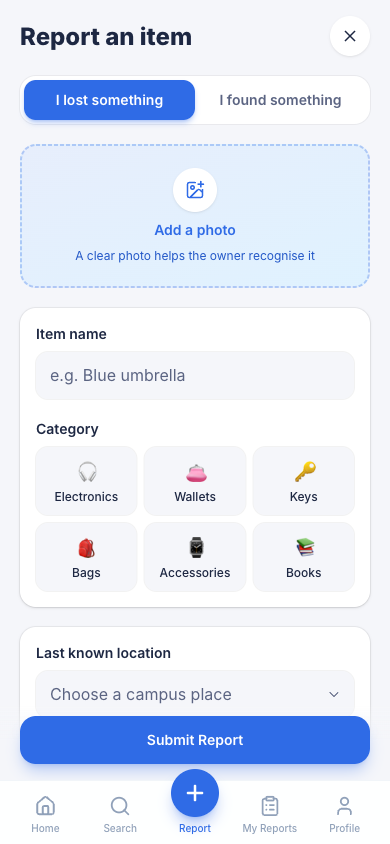
  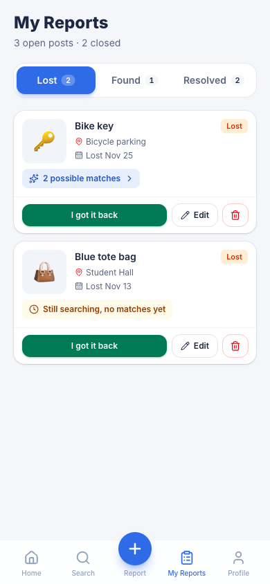
  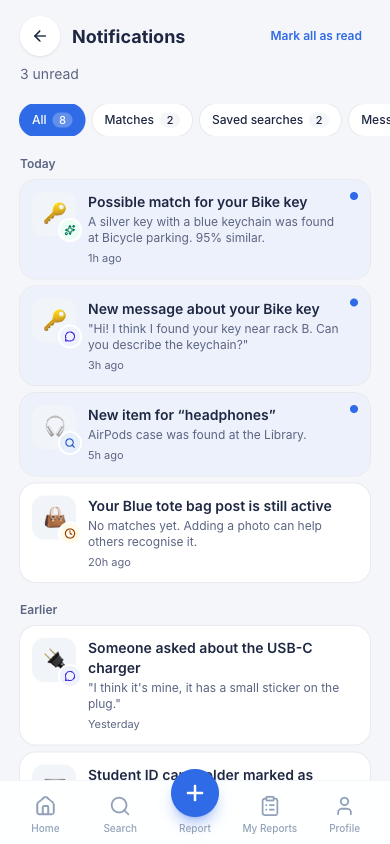
  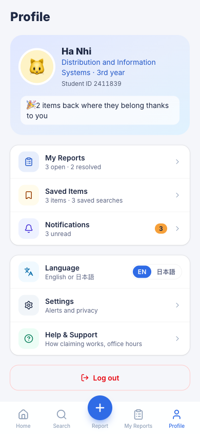
</p>

### 日本語版 (Japanese)

<p align="center">
  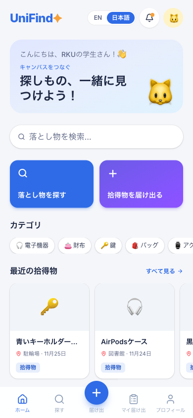
  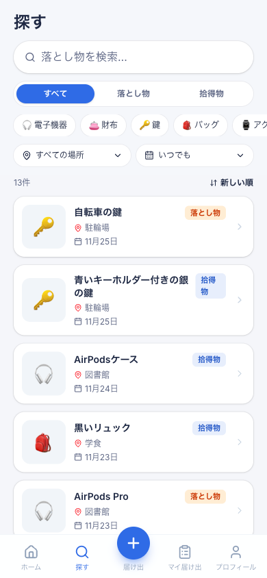
  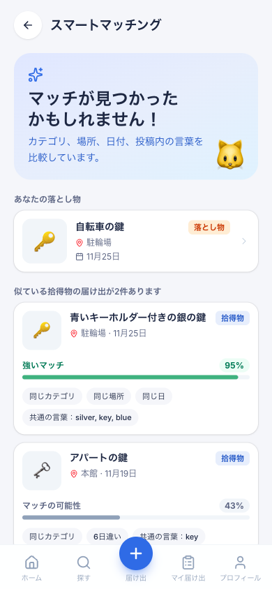
  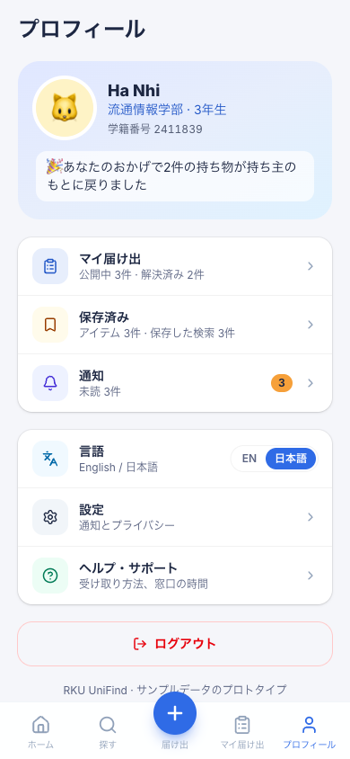
</p>

## Design

Youthful, clean and friendly, closer to a real student app than an administrative website.

- Mobile-first, shown inside an iPhone frame on desktop and full screen on phones
- Bilingual: English and Japanese, switchable from Home or Profile
- Rounded cards and buttons, soft university-inspired blue with a warm accent
- Reusable UI components and one consistent style across every screen
- The "UniFind✦" wordmark is a placeholder; it is not the official RKU logo

## Tech Stack

- [React 19](https://react.dev) + [TypeScript](https://www.typescriptlang.org)
- [Vite](https://vite.dev)
- [Tailwind CSS v4](https://tailwindcss.com)
- [React Router](https://reactrouter.com)
- [Lucide](https://lucide.dev) icons
- [oxlint](https://oxc.rs) for linting

## Getting Started

```bash
npm install
npm run dev
```

Then open the local URL printed in the terminal.

Other scripts:

```bash
npm run build     # type-check and build for production
npm run preview   # preview the production build
npm run lint      # lint the code
```

## Project Structure

```
src/
├── screens/      # Home, Search, Report, ItemDetails, Matches, MyReports, Notifications, Profile
├── components/   # Reusable UI (cards, badges, sheets, forms, navigation)
├── data/         # Sample data, types, providers and the matching logic
├── i18n/         # English and Japanese dictionaries and the language provider
├── hooks/        # Shared hooks
└── utils/        # Generic helpers
```
